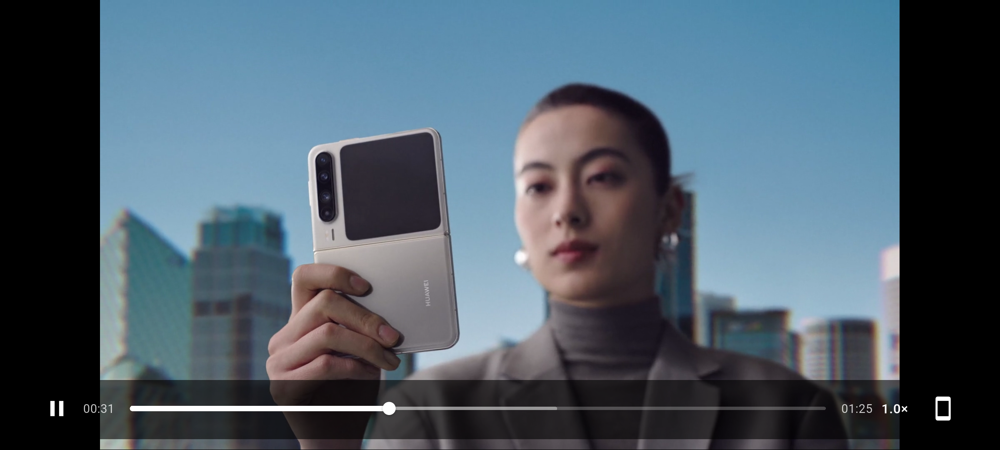
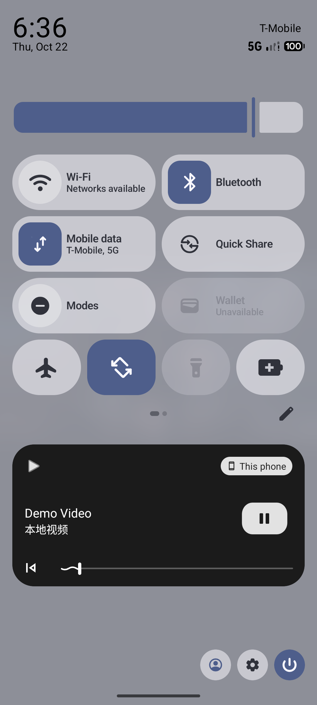

# Flutter Android Player

## 1. 项目介绍

`Flutter Android Player` 是一个用于验证 **Flutter 界面 + Android 原生 Kotlin 播放器** 技术路线的 Demo。

播放器核心使用 AndroidX Media3 的 **ExoPlayer**，视频画面通过 Android 原生 `PlayerView` + `TextureView` 嵌入 Flutter `PlatformView`。Flutter 负责播放器界面、手势和交互；Kotlin 负责媒体解码、播放控制、生命周期、媒体会话和后台播放。

核心链路：

```text
Flutter UI / 手势
    │ MethodChannel
    ▼
Kotlin ExoPlayer
    │ Surface / TextureView
    ▼
Flutter PlatformView
    │
    ├─ Player.Listener + 250ms 状态快照
    ▼
EventChannel
    │
    ▼
Flutter 实时更新播放状态
```

主要验证内容：

- ExoPlayer 播放本地固定视频；
- Flutter 页面嵌入 Android 原生视频画面；
- Flutter 控制播放/暂停、seek、倍速；
- Android 向 Flutter 持续回传状态；
- 播放器生命周期、媒体会话、后台播放；
- 横竖屏、亮度、音量、控制栏显隐等播放器交互。

### 界面预览

竖屏控制栏：


横屏控制栏：



系统媒体空间：



---

## 2. 运行方式

### 2.1 环境要求

- Flutter 3.47 或兼容版本；
- Dart 3.13 或兼容版本；
- Android Studio / Android SDK；
- Android 模拟器或真机；
- 建议使用真机验证媒体会话、通知和后台播放。

### 2.2 准备本地视频

由于视频文件较大，仓库中**不提交** `demo.mp4`。

拉取项目后，请自行准备一个 H.264 + AAC 编码的 MP4，放到：

```text
android/app/src/main/assets/demo.mp4
```

文件名必须保持为 `demo.mp4`，因为原生代码固定加载：

```text
asset:///demo.mp4
```

说明见：

```text
android/app/src/main/assets/README.md
```

### 2.3 运行

在项目根目录执行：

```powershell
flutter pub get
flutter devices
flutter run -d emulator-5554
```

如果有多台设备，把 `emulator-5554` 换成 `flutter devices` 中显示的设备 ID。

如果终端找不到 `flutter` 命令，可以直接使用完整路径：

```powershell
D:\flutter\bin\flutter.bat run -d emulator-5554
```

### 2.4 通知权限

Android 13 及以上系统首次启动会请求通知权限：

- 允许通知：系统媒体空间可以显示播放卡片；
- 拒绝通知：前台服务可能仍能运行，但媒体空间展示会受影响。

### 2.5 Android Studio

用 Android Studio 直接打开项目根目录，不要只打开 `android/` 子目录：

```text
D:\HMProjects\Flutter-Android-Player
```

选择模拟器或真机后运行 `lib/main.dart`。

### 2.6 常用命令

```powershell
flutter analyze
flutter test
flutter build apk --debug
flutter clean
```

Windows 下也可以使用项目脚本：

```powershell
.\scripts\run-emulator.ps1
```

---

## 3. 功能介绍

### 3.1 视频播放

- 使用 ExoPlayer 播放本地固定视频；
- 使用 `PlayerView` + `TextureView` 输出画面；
- 通过 Flutter `PlatformView` 嵌入页面；
- 支持播放、暂停、seek、倍速。

### 3.2 手势控制

| 操作 | 行为 |
|---|---|
| 单击画面 | 显示 / 隐藏底部控制栏 |
| 双击画面 | 播放 / 暂停 |
| 左右滑动 | 快进 / 快退 |
| 长按画面 | 临时 2× 倍速，松手恢复 |
| 左侧上下滑动 | 调节亮度 |
| 右侧上下滑动 | 调节音量 |

### 3.3 底部控制栏

- 播放 / 暂停；
- 当前时间 / 总时长；
- 可拖动进度条；
- 倍速菜单：0.5× / 1.0× / 1.5× / 2.0×；
- 横竖屏切换按钮；
- 播放中保持屏幕常亮。

### 3.4 实时状态同步

Android 侧通过 `Player.Listener` 和 250ms 定时快照，经 EventChannel 向 Flutter 推送：

- 播放状态：idle / buffering / ready / ended；
- 当前播放位置；
- 总时长；
- 已缓冲位置；
- 是否正在播放；
- 用户是否希望播放；
- 当前倍速；
- 当前音量。

Flutter 根据这些状态更新按钮、进度条、HUD 和错误提示。

### 3.5 横竖屏与亮度/音量

- 底部按钮切换横屏 / 竖屏；
- 横屏进入沉浸模式，底部控制栏自动调整布局；
- 左侧上下滑动调节窗口亮度；
- 右侧上下滑动调节播放器音量；
- 亮度/音量变化实时显示百分比 HUD；
- 模拟器下窗口背光通常不生效，因此额外使用视觉遮罩模拟亮度变化。

### 3.6 系统媒体会话

- ExoPlayer 绑定 Android MediaSession；
- 系统媒体空间显示 `Demo Video / 本地视频`；
- 可在系统媒体空间中播放、暂停、seek；
- MediaSession 和 Flutter 页面使用同一个播放器实例，状态保持同步。

### 3.7 后台播放

- 使用 `PlaybackService` 前台服务承载媒体通知；
- App 按 Home 退到后台或锁屏后，音频继续播放；
- 系统媒体会话保持可用；
- 返回 App 后视频画面重新绑定，播放进度保持连续；
- 退出 App 时停止服务并释放播放器。

---

## 4. 约束与限制

### 4.1 Demo 定位

这是技术路线验证 Demo，不是生产级播放器：

- 只有单个视频；
- 视频地址固定为 `asset:///demo.mp4`；
- 没有视频列表、播放历史、设置页和后台服务端。

### 4.2 视频文件

- `demo.mp4` 不提交到 Git；
- 拉取仓库后必须自行补充视频；
- 如果没有视频，播放器会初始化失败或无法播放；
- 当前测试视频分辨率、时长和编码会影响播放性能。

### 4.3 后台播放限制

当前实现：

- 播放器仍由 Activity 进程中的 `SimplePlayer` 持有；
- 前台服务负责保持进程和媒体通知；
- 支持 Home / 锁屏场景下的后台音频播放；
- Activity 被系统销毁或用户退出后，播放会停止；
- 没有实现进程死亡恢复；
- 后台只能继续音频，不能看到视频画面；
- 如需真正的长期后台播放，应把播放器移入 `MediaSessionService` 并由服务统一管理生命周期。

### 4.4 媒体会话限制

- 媒体会话元数据固定为 `Demo Video / 本地视频`；
- 没有配置封面图；
- 只有单视频，没有上一首/下一首；
- 通知权限被拒绝时，系统媒体空间展示可能不完整；
- 前台服务类型为 `mediaPlayback`，依赖 Android 的前台服务限制。

### 4.5 亮度与音量

- 亮度只调整当前 App 窗口亮度，不修改系统全局亮度；
- 模拟器不会真正应用窗口背光，Demo 使用 Flutter 遮罩模拟；
- 真机使用窗口亮度，不使用模拟器遮罩；
- 音量只调整 ExoPlayer 播放器音量，不修改系统媒体音量；
- 亮度/音量状态没有持久化。

### 4.6 画面渲染

当前使用 `TextureView`：

- 优点：视频和 Flutter 覆盖层的触摸行为更稳定；
- 缺点：比 `SurfaceView` 多一次 GPU 拷贝；
- 高分辨率、高帧率场景需要重新评估渲染方案。

### 4.7 方向与设备

- 横竖屏切换依赖 Android 方向锁定；
- Android 16 大屏设备可能忽略方向锁定；
- 横屏沉浸模式未单独适配刘海/挖孔安全区；
- 建议使用手机模拟器或真机验证。

### 4.8 未实现功能

当前 Demo 不包含：

- HLS / DASH；
- DRM；
- 字幕和音轨选择；
- 画中画（PiP）；
- 播放列表和多播放器；
- 离线下载；
- 投屏；
- 视频编辑、滤镜、截图；
- 自动化 Android 原生播放器测试。

平台视图、媒体会话、通知和后台播放建议在真机上做回归验证。

---

## 相关文档

- [完整技术方案](docs/technical-plan.md)
- [极简 Demo 落地手册](docs/simplified-demo.md)
- [Demo 扩展需求](docs/Demo扩展需求.md)
