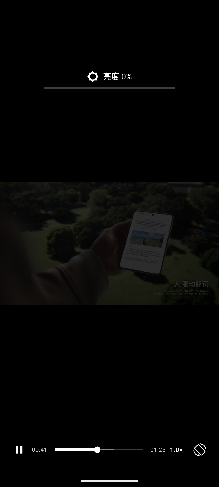
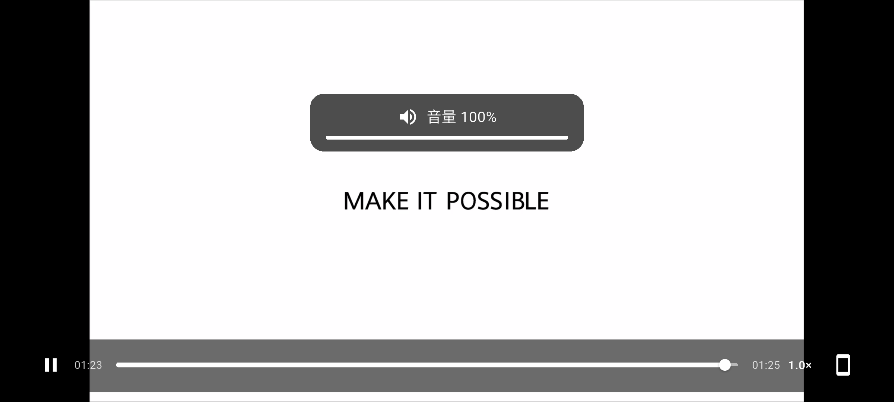
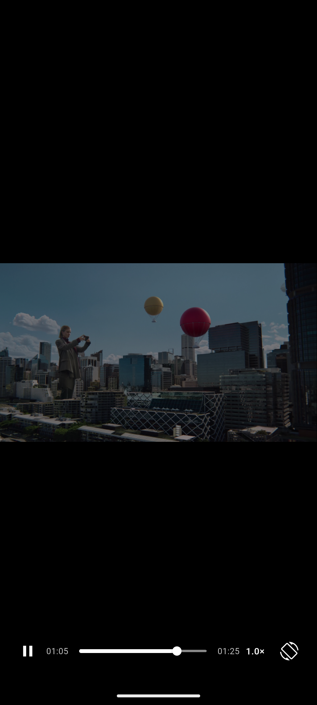

# Demo 扩展需求

> 文档目的：记录在基础 Flutter + Android 原生 ExoPlayer 播放器 Demo 上新增的六项扩展能力，以及对应的实现方式、验证结果和取舍。
>
> 状态：已完成，并已在 Android 模拟器验证。

---

## 界面截图

竖屏控制栏：


横屏控制栏：


亮度调节 HUD：



音量调节 HUD：



系统媒体空间：


---

## 1. 扩展需求范围

在原有播放器基础上新增：

1. 横竖屏切换按钮，点击切换视频横屏/竖屏，并调整底部控制栏布局。
2. 屏幕左侧上下滑动调节亮度，实时显示亮度 HUD。
3. 屏幕右侧上下滑动调节音量，实时显示音量 HUD。
4. 点击屏幕，切换画面之上播放控制 UI 的显示/隐藏。
5. 接入 MediaSession，在系统媒体空间展示播放卡片，并支持系统侧播放/暂停/seek。
6. 支持后台播放：App 退到后台或锁屏后音频继续，媒体会话保留，返回页面后状态同步。

保留原有能力：

- 双击播放/暂停；
- 左右滑动快进/快退；
- 长按 2× 倍速；
- 播放/暂停按钮；
- 进度条 seek；
- 倍速菜单；
- 实时状态同步；
- 后台播放和退出释放。

---

## 2. 交互总览

| 操作 | 行为 |
|---|---|
| 单击画面 | 显示 / 隐藏播放控制 UI |
| 双击画面 | 播放 / 暂停 |
| 左右滑动 | 快进 / 快退 |
| 长按画面 | 临时 2× 倍速，松手恢复 |
| 左侧上下滑动 | 调节亮度 |
| 右侧上下滑动 | 调节音量 |
| 底部播放按钮 | 播放 / 暂停 |
| 底部进度条 | 拖动 seek |
| 底部倍速菜单 | 0.5× / 1.0× / 1.5× / 2.0× |
| 底部横竖屏按钮 | 横屏 / 竖屏切换 |
| 系统媒体空间 | 播放卡片、播放/暂停、seek |
| 退到后台 / 锁屏 | 音频继续播放，媒体会话保留 |

---

## 3. 功能说明

### 3.1 横竖屏切换

入口：

- 底部控制栏最右侧增加横竖屏切换按钮。

行为：

- 竖屏点击后切换到横屏；
- 横屏点击后切回竖屏；
- 横屏时进入沉浸模式，隐藏系统状态栏和导航栏；
- 竖屏时恢复普通系统 UI；
- 视频继续播放，播放器实例不会重建；
- 页面销毁时恢复默认方向和系统 UI。

底部控制栏适配：

- 竖屏使用较小的左右边距；
- 横屏使用更大的左右边距和更低的底部位置；
- 控制栏始终位于画面之上，不因横屏被裁掉。

### 3.2 左侧上下滑动调节亮度

行为：

- 在屏幕左半区上下滑动；
- 向上滑动提高亮度；
- 向下滑动降低亮度；
- 亮度范围限制在 1% 到 100%。

UI：

- 屏幕上方显示“亮度 XX%”；
- 显示亮度图标；
- 显示实时进度条；
- 松手约 650ms 后自动消失；
- 即使播放控制 UI 已隐藏，亮度 HUD 仍然显示。

实现范围：

- 只调整当前 App 窗口亮度；
- 不修改系统全局亮度；
- 不需要 `WRITE_SETTINGS` 权限；
- App 退出后窗口亮度自然失效。

模拟器补充说明：

- Android 模拟器通常不会真正应用 `Window.screenBrightness` 的背光变化，所以只调用原生窗口亮度时，模拟器画面看起来没有变化；
- 因此增加了模拟器兜底：检测到运行在模拟器时，在视频画面上叠加一层随亮度变化的黑色遮罩；
- 真机不会使用这层遮罩，仍然使用窗口亮度；
- 遮罩只覆盖视频区域，播放控制栏和 HUD 保持清晰；
- 这层遮罩是 Demo 的视觉模拟方案，不是系统背光调节。

### 3.3 右侧上下滑动调节音量

行为：

- 在屏幕右半区上下滑动；
- 向上滑动增大音量；
- 向下滑动减小音量；
- 音量范围限制在 0% 到 100%。

UI：

- 显示“音量 XX%”；
- 根据音量显示音量图标，0% 时显示静音图标；
- 显示实时进度条；
- 松手约 650ms 后自动消失。

实现范围：

- 调整 ExoPlayer 的播放器音量；
- 不修改系统媒体音量；
- 音量变化会进入 EventChannel 状态快照，Flutter 侧同步显示。

### 3.4 点击切换控制 UI

行为：

- 单击画面切换底部控制栏显示/隐藏；
- 控制栏隐藏时，视频画面完整显示；
- 再次点击恢复控制栏；
- 双击仍然是播放/暂停，不会触发控制栏显隐。

实现细节：

- 使用 `AnimatedOpacity` 实现淡入淡出；
- 隐藏时使用 `IgnorePointer` 禁止误触；
- 横屏、竖屏都支持；
- 亮度/音量 HUD 不受控制栏显隐影响。

---

## 4. 技术实现

### 4.1 整体结构

```text
Flutter UI
  ├─ 全屏手势层
  │    ├─ 单击：控制 UI 显隐
  │    ├─ 双击：播放/暂停
  │    ├─ 水平拖动：seek
  │    ├─ 垂直拖动：亮度/音量
  │    └─ 长按：2× 倍速
  │
  ├─ 底部控制栏
  │    ├─ 播放/暂停
  │    ├─ 进度条
  │    ├─ 时间
  │    ├─ 倍速菜单
  │    └─ 横竖屏切换
  │
  ├─ 亮度/音量 HUD
  └─ 缓冲/错误/HUD 提示

     │ MethodChannel
     ▼
Android Kotlin
  ├─ SimplePlayer：播放控制、音量、状态回传
  ├─ WindowControl：窗口亮度
  ├─ VideoPlatformView / PlayerView：画面
  └─ ExoPlayer：解码与播放
```

### 4.2 Flutter 侧

主要工作：

- 增加控制栏显隐状态；
- 增加横竖屏状态；
- 增加亮度、音量本地状态；
- 增加垂直拖动识别；
- 增加亮度/音量 HUD；
- 增加横竖屏按钮。

涉及文件：

- `lib/main.dart`
- `lib/window_controller.dart`（新增）
- `lib/demo_player_controller.dart`

### 4.3 Android 侧

新增窗口亮度通道：

```text
demo/window_controls
```

支持：

- `getBrightness`：读取当前窗口亮度，读不到时回退到系统亮度；
- `setBrightness`：设置当前 Activity 窗口亮度；
- `isEmulator`：判断是否运行在模拟器，供 Flutter 决定是否启用亮度遮罩。

音量控制复用播放器命令通道：

```text
demo/player_commands
```

新增：

- `setVolume`

播放器状态快照新增：

- `volume`

涉及文件：

- `android/app/src/main/kotlin/com/example/flutter_android_player/WindowControl.kt`（新增）
- `.../SimplePlayer.kt`
- `.../MainActivity.kt`

### 4.4 手势冲突处理

同一条手势层同时支持：

- 水平拖动；
- 垂直拖动；
- 单击；
- 双击；
- 长按。

处理方式：

- Flutter 手势竞技场根据初始移动方向区分水平拖动和垂直拖动；
- 垂直拖动开始时，根据触点横坐标判断左半区/右半区；
- 左半区进入亮度模式，右半区进入音量模式；
- 单击和双击由 Flutter 标准手势识别处理；
- 底部 Slider、按钮位于手势层之上，优先接收触摸。

### 4.5 渲染方式调整：SurfaceView → TextureView

本次将 `PlayerView` 的渲染方式改为：

```text
app:surface_type="texture_view"
```

原因：

- `SurfaceView` 性能更好，但它是独立 Surface 层；
- 在横屏时，视频区域可能拦截触摸，导致 Flutter 上层的点击和手势不稳定；
- 改用 `TextureView` 后，视频和 Flutter 覆盖层的触摸行为更稳定；
- 横屏点击、亮度和音量手势都能正常工作。

代价：

- 每帧多一次 GPU 拷贝；
- 高分辨率、高帧率场景性能不如 SurfaceView。

对当前 Demo 来说，交互稳定性优先，因此选择 TextureView。

---

## 5. 文件变更

| 文件 | 变更 |
|---|---|
| `lib/main.dart` | 横竖屏、亮度/音量手势、HUD、控制栏显隐、横屏布局 |
| `lib/window_controller.dart` | 新增窗口亮度 MethodChannel 封装 |
| `lib/demo_player_controller.dart` | 增加 `setVolume`，状态快照增加 `volume` |
| `.../WindowControl.kt` | 新增窗口亮度原生实现 |
| `.../SimplePlayer.kt` | 增加 `setVolume`，状态增加 `volume` |
| `.../MainActivity.kt` | 创建和释放 WindowControl |
| `res/layout/player_view.xml` | `surface_type` 改为 `texture_view` |

---

## 6. 验证结果

### 6.1 横竖屏切换

- 竖屏 → 横屏：通过；
- 横屏 → 竖屏：通过；
- 切换后视频继续播放；
- 横屏控制栏正常显示；
- 退出页面后方向和系统 UI 恢复。

### 6.2 亮度调节

- 左侧上下滑动触发窗口亮度调整；
- 原生日志出现 `WindowControl: setBrightness(...)`；
- 模拟器上通过黑色遮罩体现视觉亮度变化；
- HUD 显示“亮度 XX%”和进度条；
- 松手后 HUD 自动消失。

### 6.3 音量调节

- 右侧上下滑动触发播放器音量调整；
- 原生日志出现 `SimplePlayer: setVolume(...)`；
- HUD 显示“音量 XX%”和进度条；
- 音量状态能通过 EventChannel 同步。

### 6.4 控制 UI 显隐

- 竖屏单击隐藏控制栏；
- 再次单击恢复；
- 横屏单击隐藏/恢复；
- 双击不会误触发控制栏显隐；
- 控制栏隐藏后，亮度/音量 HUD 仍能显示。

### 6.5 回归验证

原有能力保持正常：

- 双击播放/暂停；
- 左右滑动 seek；
- 长按 2×；
- 底部播放按钮；
- 进度条 seek；
- 倍速菜单；
- 状态回传；
- 后台播放；
- 退出释放。

构建检查：

- `flutter analyze` 无问题；
- `flutter build apk --debug` 成功；
- 已在 Android 模拟器安装运行。

---

## 7. 当前限制

1. 横竖屏切换依赖 Android 的方向锁定；Android 16 大屏设备可能忽略方向锁定，需要响应式布局兜底。
2. 亮度只调整当前 App 窗口，不修改系统亮度；Android 模拟器不会真正应用窗口背光，Demo 通过模拟器专用的黑色遮罩来体现亮度变化。
3. 音量只调整 ExoPlayer 播放器音量，不修改系统媒体音量。
4. 亮度/音量状态没有持久化，重新进入 App 后使用默认值或当前窗口/系统值。
5. 控制栏目前由用户点击显隐，没有自动隐藏计时。
6. TextureView 比 SurfaceView 多一次 GPU 拷贝，4K/高帧率场景需要重新评估。
7. 横屏沉浸模式下未单独处理刘海/挖孔安全区，后续可按设备适配。

---

## 8. 后续可扩展方向

- 控制栏 3 秒无操作自动隐藏；
- 亮度/音量设置持久化；
- 使用 AudioManager 调整系统媒体音量；
- 横屏时按刘海安全区调整控制栏；
- 全屏按钮与横竖屏按钮合并；
- 双击左右两侧快进/快退（类似短视频播放器）；
- 手势灵敏度可配置；
- 高性能场景重新评估 SurfaceView + 原生触摸转发。

---

## 9. 媒体会话与媒体空间

### 目标

视频播放时接入 Android MediaSession：

- 在系统媒体空间/快捷设置中显示播放卡片；
- 显示视频标题和来源；
- 可以从系统媒体空间播放、暂停、seek；
- 系统媒体空间的播放状态与 Flutter 页面保持同步。

### 实现方式

- 引入 `androidx.media3:media3-session`；
- 使用当前 ExoPlayer 创建 `MediaSession`；
- 为视频设置媒体元数据：
  - 标题：`Demo Video`
  - 来源：`本地视频`
- 使用 `MediaStyle` 通知挂载 MediaSession；
- 系统媒体空间的控制命令直接进入 MediaSession，再转发给 ExoPlayer；
- Flutter 页面仍然通过现有 EventChannel 接收播放状态，因此系统控制和页面 UI 会同步；
- 通知上的播放/暂停按钮通过 `MediaActionReceiver` 控制播放器；
- Android 13+ 启动时请求通知权限。

### 媒体空间效果


媒体空间中包含：

- 标题 `Demo Video`；
- 来源 `本地视频`；
- 播放/暂停按钮；
- 进度条；
- 当前播放设备信息。

### 验证结果

- `cmd media_session list-sessions` 能看到当前应用的 MediaSession；
- MediaSession 状态在 `PLAYING` 和 `PAUSED` 之间正确变化；
- 按系统媒体键 `KEYCODE_MEDIA_PLAY_PAUSE` 可以暂停/播放；
- 媒体空间点击播放后，Flutter 页面状态同步变为“播放中”；
- 媒体空间和页面使用同一个 ExoPlayer，状态不会分叉。

### 当前限制

- MediaSession 目前绑定在 Activity 的播放器实例上；
- 当前已经通过前台服务支持 App 退到后台/锁屏后的音频播放；
- 但播放器仍由 Activity 进程中的 SimplePlayer 持有，Activity 被系统销毁或用户退出后播放会停止；
- 如果需要在 App 退出后继续播放、进程被杀后恢复，应升级为 MediaSessionService 持有播放器并管理前台服务；
- 当前未配置封面图，媒体空间使用系统默认图标；
- 当前没有上一首/下一首，只有单视频。

### 涉及文件

| 文件 | 变更 |
|---|---|
| `android/app/build.gradle.kts` | 增加 `media3-session` |
| `.../SimplePlayer.kt` | 创建 MediaSession，绑定播放器 |
| `.../MediaNotificationManager.kt` | 新增媒体通知/媒体空间通知 |
| `.../MediaActionReceiver.kt` | 新增通知播放/暂停按钮接收器 |
| `.../MainActivity.kt` | Android 13+ 通知权限请求 |
| `AndroidManifest.xml` | 通知权限和媒体按钮 Receiver |

---

## 10. 后台播放

### 目标

- App 按 Home 退到后台后，视频音频继续播放；
- 锁屏后音频继续；
- 系统媒体空间保持可见，并可控制播放/暂停；
- 返回 App 时画面和进度与后台播放状态同步。

### 实现方式

新增 `PlaybackService` 前台服务：

- 服务类型为 `mediaPlayback`；
- 使用 MediaStyle 媒体通知作为前台服务通知；
- 通知 ID 与媒体通知一致；
- App 在后台时服务保持进程存活，音频继续播放；
- 退出页面时停止服务、移除通知、释放播放器。

生命周期调整：

- `MainActivity.onPause()` 不再暂停播放器；
- `VideoPlatformView.dispose()` 只解绑 Surface，不再调用暂停；
- Flutter 侧生命周期回调不再强制把 UI 置为暂停；
- 只有 Activity 真正销毁或用户退出时，才 `release()` 播放器并停止服务。

Manifest 增加：

- `FOREGROUND_SERVICE`
- `FOREGROUND_SERVICE_MEDIA_PLAYBACK`
- `PlaybackService`，`foregroundServiceType="mediaPlayback"`

### 验证结果

按 Home 后：

- 系统媒体会话状态仍为 `PLAYING`；
- 播放位置继续增长，例如从 26.8s 到 39.2s；
- 前台服务处于 `isForeground=true`；
- 没有出现 `SimplePlayer: pause()`。

返回 App 后：

- 页面恢复播放状态；
- 时间继续推进；
- 视频画面重新绑定 Surface，播放器实例没有重建。



按 Back 退出后：

- 日志出现 `SimplePlayer: release()`；
- 前台服务消失；
- `media_session list-sessions` 会话消失。

### 当前限制

- 播放器仍由 Activity 进程中的 `SimplePlayer` 持有；
- 适合 Home/锁屏这种“Activity 仍存活”的后台场景；
- 如果 Activity 被系统销毁，或用户强制退出，播放会停止；
- 如果要做真正的“服务持有播放器、进程死亡后恢复”，需要把 ExoPlayer 和 MediaSession 移入 MediaSessionService；
- 后台播放的是音频，视频画面不会显示；画中画是另一个独立需求；
- 服务使用 `START_NOT_STICKY`，不保证进程被杀后自动恢复。

### 涉及文件

| 文件 | 变更 |
|---|---|
| `.../PlaybackService.kt` | 新增前台播放服务 |
| `.../SimplePlayer.kt` | 启动/停止服务 |
| `.../MainActivity.kt` | 移除后台暂停逻辑 |
| `.../VideoPlatformView.kt` | dispose 时只解绑 Surface，不暂停 |
| `.../MediaNotificationManager.kt` | 提供前台服务通知 |
| `AndroidManifest.xml` | 前台服务权限和 Service 声明 |

---

## 11. 结论

本次扩展完成了六项能力：

- 横竖屏切换；
- 左侧亮度手势 + HUD；
- 右侧音量手势 + HUD；
- 单击切换控制 UI；
- MediaSession 接入系统媒体空间，并支持系统侧播放控制；
- 前台服务 + 媒体通知支持后台播放。

同时保留了原有播放、seek、倍速、状态同步和生命周期能力。  
当前 Demo 已具备一个短视频播放器常见的核心交互形态。
